<h1 align="center">
  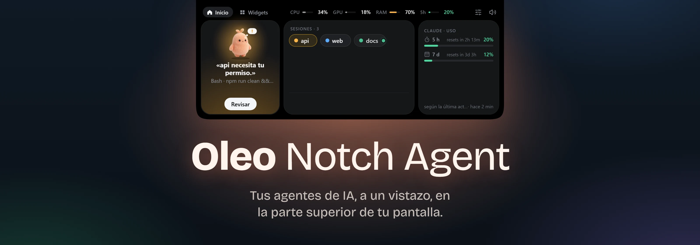
</h1>

<p align="center">
  <a href="README.md">English</a> · <b>Español</b>
</p>

<p align="center">
  
  
  
  
  
  <a href="LICENSE"></a>
  <a href="https://github.com/icarlocl/Oleo-Notch-Agent/commits/main"></a>
  <a href="https://github.com/icarlocl/Oleo-Notch-Agent/stargazers"></a>
</p>

<p align="center">
  <a href="#qué-es-oleo">Qué es</a> ·
  <a href="#cómo-se-ve">Capturas</a> ·
  <a href="#funciones">Funciones</a> ·
  <a href="#instalación">Instalación</a> ·
  <a href="#conecta-tus-agentes">Conectar</a> ·
  <a href="#cómo-funciona">Cómo funciona</a> ·
  <a href="#privacidad-y-red">Privacidad</a> ·
  <a href="#compilar-desde-el-código">Compilar</a> ·
  <a href="#licencia-y-créditos">Licencia</a>
</p>

## ¿Qué es Oleo?

Abres varias sesiones de programación con IA en proyectos distintos y pronto
pierdes el hilo: cuál está trabajando, cuál terminó y cuál lleva diez minutos
esperándote.

**Oleo Notch Agent** las reúne todas en una isla pequeña en la parte superior
de tu pantalla. Ves cada sesión de un vistazo, con su proyecto, su estado y lo
último que dijo. Cuando un agente pide permiso para ejecutar un comando o
editar un archivo, o te hace una pregunta, respondes desde la isla con un clic,
sin salir de lo que estabas haciendo. Un peluche color durazno llamado
**Durazno** vive en la isla y muestra cómo van tus sesiones.

Oleo funciona con **Claude Code**, **Codex** y **Cursor**. Se ejecuta en tu
equipo y solo habla con tus propios agentes: sin cuenta y sin telemetría.

> [!NOTE]
> Oleo es una versión temprana (0.2.3). Windows 10 y 11 son el objetivo
> principal; el mismo código también compila para Linux, de forma
> experimental. La interfaz está en español, inglés y portugués. Oleo es un
> proyecto independiente y no está afiliado ni respaldado por Anthropic, OpenAI
> ni Cursor.

## Cómo se ve

<div align="center">

<picture><source media="(prefers-color-scheme: light)" srcset="docs/assets/screens/hero-light.webp">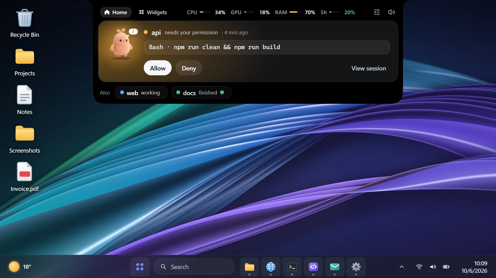</picture>

</div>

<br>

<table>
<tr>
<td width="50%"><picture><source media="(prefers-color-scheme: light)" srcset="docs/assets/screens/over-editor-light.webp">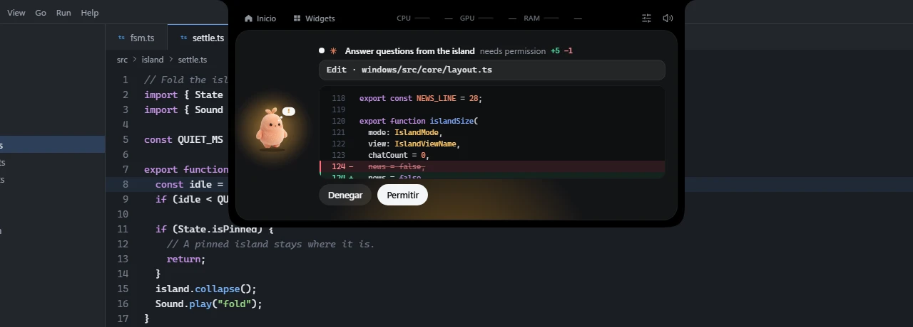</picture><br><sub><b>Aprueba con un diff.</b> Una edición muestra las líneas que cambian antes de que hagas clic.</sub></td>
<td width="50%"><picture><source media="(prefers-color-scheme: light)" srcset="docs/assets/screens/question-light.webp">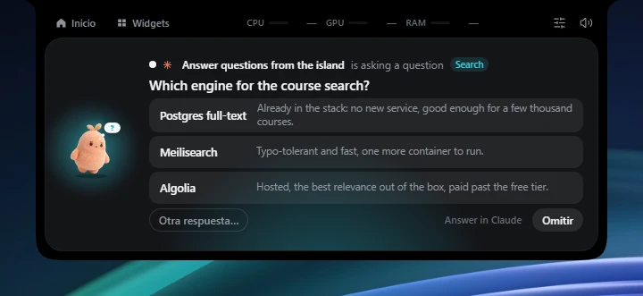</picture><br><sub><b>Responde preguntas.</b> Elige una opción, escribe la tuya u omítela.</sub></td>
</tr>
<tr>
<td width="50%"><picture><source media="(prefers-color-scheme: light)" srcset="docs/assets/screens/session-agents-light.webp">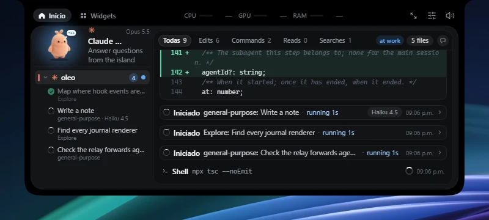</picture><br><sub><b>Sigue una sesión.</b> Un diario de lo que hizo y sus subagentes.</sub></td>
<td width="50%"><picture><source media="(prefers-color-scheme: light)" srcset="docs/assets/screens/shelf-light.webp">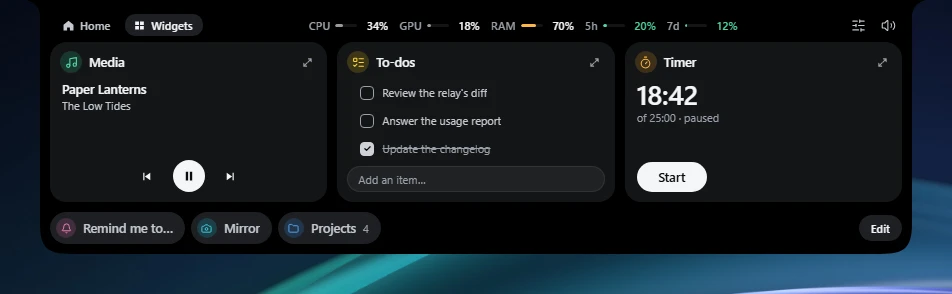</picture><br><sub><b>Widgets.</b> Multimedia, tareas, temporizador, recordatorios y más, a un deslizamiento.</sub></td>
</tr>
<tr>
<td width="50%"><picture><source media="(prefers-color-scheme: light)" srcset="docs/assets/screens/over-browser-tabs-light.webp">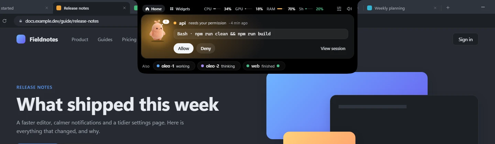</picture><br><sub><b>Sin estorbar.</b> Flota sobre las pestañas y no le quita espacio a tu página.</sub></td>
<td width="50%"><picture><source media="(prefers-color-scheme: light)" srcset="docs/assets/screens/dock-bottom-light.webp">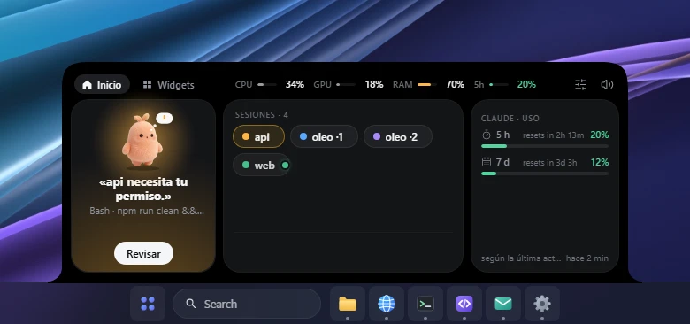</picture><br><sub><b>Acóplala donde quieras.</b> Borde superior, inferior, izquierdo o derecho.</sub></td>
</tr>
<tr>
<td width="50%"><picture><source media="(prefers-color-scheme: light)" srcset="docs/assets/screens/settings-hooks-diff-light.webp">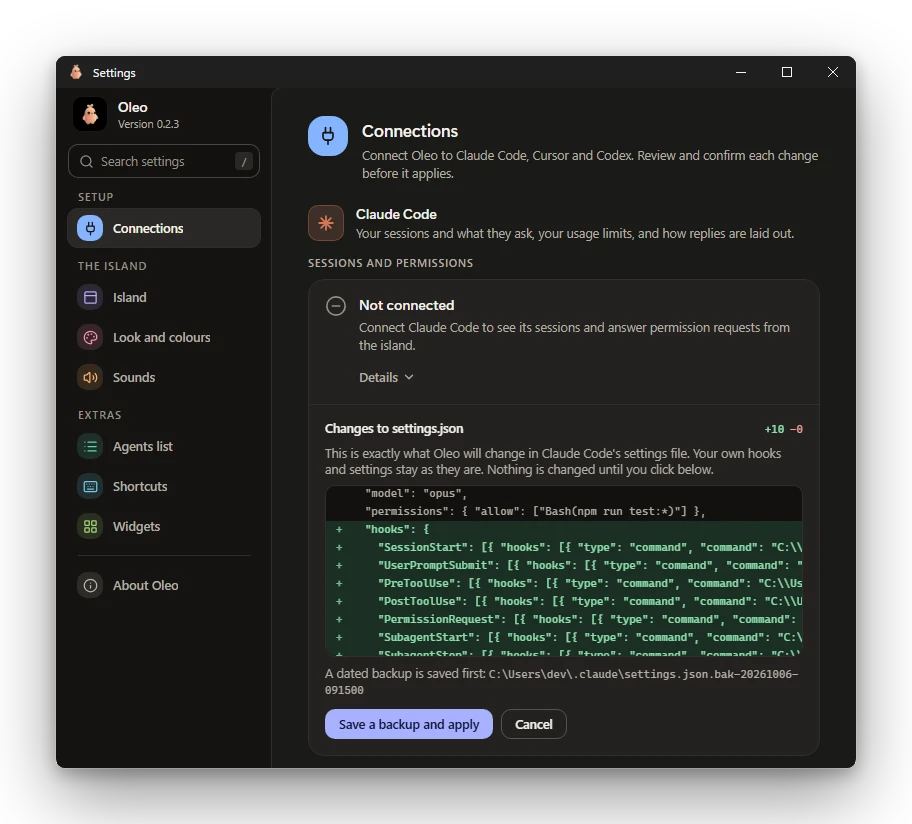</picture><br><sub><b>Nada cambia a tus espaldas.</b> Ves el diff de tu configuración antes de que Oleo la escriba.</sub></td>
<td width="50%"><picture><source media="(prefers-color-scheme: light)" srcset="docs/assets/screens/settings-look-light.webp">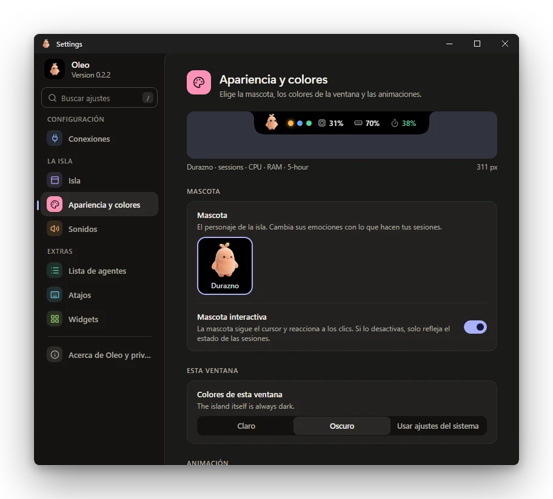</picture><br><sub><b>Conoce a Durazno.</b> Sigue el puntero y reacciona a los clics; puedes desactivarlo.</sub></td>
</tr>
</table>

Las capturas las genera el propio proyecto: son la isla real manejada por
sesiones inventadas sobre un escritorio inventado (ver [Capturas](#capturas)
más abajo).

## Funciones

| Función | Qué ofrece |
|---|---|
| **Todas las sesiones de un vistazo** | Una página con todas las sesiones en marcha: el proyecto, su estado (trabajando, te necesita, lista), el último mensaje, sus subagentes y un botón para volver a la ventana donde corre. |
| **Aprueba desde la isla** | Los permisos y las preguntas se responden desde la isla, con Claude Code y Codex. Las ediciones muestran un diff real. Nada se aprueba sin tu clic. |
| **Responde desde la isla** | En Windows, cuando termina un turno de Claude Code o Codex, escribes la respuesta en su tarjeta. Oleo la teclea en la terminal de esa sesión, o abre la sesión en VS Code o Cursor con la respuesta en su cuadro de texto. |
| **Claude Code, Codex y Cursor** | Cada sesión lleva la marca de su herramienta. Claude Code y Codex se pueden responder desde la isla; las sesiones de agente de Cursor se muestran solo como estado. |
| **Límites de uso** | Tus límites de Claude de 5 horas y de 7 días, tomados de la línea de estado de Claude Code, sin llamadas de red. Cada sesión de Claude Code también muestra cuánto contexto lleva usado. |
| **Recursos** | CPU, GPU y RAM junto a tus sesiones. |
| **Durazno** | La mascota refleja el estado de tus sesiones y, si la dejas activada, sigue el puntero y reacciona a los clics. |
| **Widgets** | Una segunda pestaña con Multimedia, Tareas, Temporizador, Recordatorios, un Espejo de cámara y tus Proyectos recientes. Cada uno se puede desactivar y reordenar. |
| **Lista de agentes** | Una ventana pequeña opcional que se queda encima, con una fila por proyecto, su estado, el tiempo transcurrido y el tamaño del contexto. |
| **Clima** | Opcional. Elige una ciudad en Configuración y la temperatura aparece en la isla. Junto con la búsqueda de actualizaciones, es lo único que usa la red (ver [Privacidad](#privacidad-y-red)). |
| **Se pliega y se acopla** | Se pliega en una pequeña línea junto al borde, como la de los celulares, que se vuelve ámbar cuando una sesión te necesita; o en una cápsula con tus métricas. Se acopla a cualquier borde de la pantalla, se oculta con las aplicaciones a pantalla completa y casi no usa CPU mientras está oculta. |
| **Teclado y sonidos** | Cinco atajos globales, todos configurables, y sonidos suaves que puedes silenciar. |

### Atajos de teclado

| Atajo | Qué hace |
|---|---|
| `Ctrl` `Alt` `Espacio` | Abre el panel de sesiones en grande, o lo vuelve a reducir |
| `Ctrl` `Mayús` `Espacio` | Abre el panel de sesiones en tamaño normal, con el teclado dentro |
| `Ctrl` `Alt` `Enter` | Va a la ventana de la sesión que más te necesita y pliega la isla |
| `Ctrl` `Alt` `N` | Oculta la isla, o la vuelve a mostrar |
| `Ctrl` `Mayús` `L` | Muestra u oculta la lista de agentes (mientras esté activada) |

Puedes cambiar o desactivar cada atajo en Configuración. Los predeterminados
evitan `Ctrl` `Alt` con una letra, porque en muchas distribuciones de teclado
eso es AltGr y le quitaría un carácter a todos los demás programas.

## Instalación

Descarga `Oleo-Windows-<versión>-setup.exe` de la
[última versión publicada](https://github.com/icarlocl/Oleo-Notch-Agent/releases/latest)
y ejecútalo. Junto a él, `SHA256SUMS.txt` trae el SHA-256 del instalador y de
los dos programas que contiene. También puedes compilarlo tú (ver
[Compilar desde el código](#compilar-desde-el-código)): `npm run pack` deja los
mismos archivos en `windows\release\`.

El instalador es por usuario y no necesita permisos de administrador. No está
firmado digitalmente, así que Windows SmartScreen puede decir «Windows protegió
tu PC»: elige **Más información** y luego **Ejecutar de todas formas**, una vez
que hayas comprobado el hash:

```powershell
Get-FileHash .\Oleo-Windows-0.2.3-setup.exe -Algorithm SHA256
```

WebView2, que dibuja la isla, viene incluido en Windows 10 y 11.

## Conecta tus agentes

Oleo se entera de tus sesiones a través de los hooks que ofrece cada
herramienta. Los activas desde **Configuración → Conexiones**, una herramienta
a la vez, con el botón **Conectar…** de cada una:

| Herramienta | Qué puede hacer Oleo | Archivo que edita, tras tu clic |
|---|---|---|
| **Claude Code** | Mostrar sesiones, responder permisos y preguntas, responder mensajes y mostrar los límites de uso | `~/.claude/settings.json` |
| **Codex** | Mostrar sesiones, responder permisos y mensajes. Codex ejecuta los hooks nuevos solo cuando confías en ellos: abre Codex y revísalos una vez con `/hooks`. | `~/.codex/hooks.json` |
| **Cursor** | Mostrar las sesiones de agente, solo como estado. Sigue únicamente eventos que no pueden cambiar lo que hace Cursor, así que nunca puede permitir, denegar ni retrasar nada allí. Reinicia Cursor después. | `~/.cursor/hooks.json` |

Cada vez, Oleo te muestra el **diff exacto** de lo que va a cambiar, guarda
primero una **copia de seguridad con fecha** y no escribe nada hasta que haces
clic. Solo toca sus propias entradas y nunca los hooks de otras herramientas.
**Desconectar…** quita únicamente las entradas de Oleo, de la misma manera.
Quita los hooks desde Configuración antes de desinstalar Oleo: desinstalar no
edita tus archivos de configuración.

Después abre una sesión nueva en tu agente y aparecerá en la isla. Para verlo
sin un agente real, ejecuta `npm run fake-session` desde `windows/` con Oleo
abierto: reproduce una sesión inventada a través del relé y no ejecuta nada.

## Cómo funciona

<p align="center">
  <picture>
    <source media="(prefers-color-scheme: dark)" srcset="docs/assets/how-it-works-es-dark.svg">
    <source media="(prefers-color-scheme: light)" srcset="docs/assets/how-it-works-es-light.svg">
    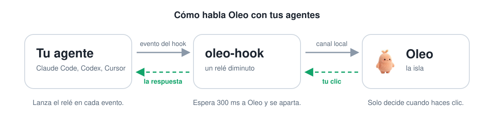
  </picture>
</p>

Cada hook ejecuta un relé diminuto, `oleo-hook`. Este envía el evento a Oleo
por un canal con nombre (named pipe), `\\.\pipe\oleo-<SID de tu usuario>`, que
solo tu cuenta de Windows (y el sistema) puede abrir. Cuando el evento es una
pregunta o una solicitud de permiso, el relé espera tu clic y le devuelve la
respuesta al agente.

- **Nunca bloquea a tu agente.** El relé le da a Oleo 300 ms para contestar. Si
  Oleo está cerrado, lento o se cayó, el relé termina al instante y el agente
  sigue como si Oleo no estuviera instalado, preguntando en su propia terminal
  como siempre.
- **Nunca aprueba nada sin un clic.** Si nadie responde a tiempo, Oleo no dice
  nada y el agente pregunta como lo hace siempre.
- **No tiene código de red.** El relé no hace ninguna llamada de red.

## Privacidad y red

- **Sin telemetría, sin rastreo, sin cuenta.**
- **Dos funciones opcionales usan internet, y las dos están apagadas hasta que
  tú las activas:**
  - *Búsqueda de actualizaciones* (Configuración → Acerca de, desactivada por
    defecto, o **Comprobar ahora**). Le pregunta a la API de GitHub por la
    última versión de este repositorio y envía solo un encabezado
    `User-Agent: Oleo/<versión>`, nada sobre ti ni sobre tu equipo. Oleo nunca
    descarga ni instala nada por sí mismo: solo abre la descarga en tu
    navegador.
  - *Clima* (Configuración → Isla, **Clima**). Al buscar una ciudad, el texto
    que escribes va a la API de geocodificación de Open-Meteo; con una ciudad
    elegida, sus coordenadas van a la API de pronóstico de Open-Meteo, como
    máximo cada 15 minutos mientras la isla está abierta. Quita la ciudad para
    desactivarlo.
- La política de seguridad de contenido de la ventana permite esos dos
  servidores y nada más.
- Lo que lee el relé (el final de una transcripción, el archivo que apunta una
  edición, la salida de un comando) va solo a Oleo por el canal local y se queda
  en memoria. El registro anota nombres de eventos y decisiones, nunca su
  contenido.
- Todo lo que guarda Oleo está en tu equipo: las preferencias en
  `%APPDATA%\Oleo` y el relé y el registro (`oleo.log`) en
  `%LOCALAPPDATA%\Oleo`.
- WebView2, el componente de Microsoft que dibuja la ventana, lo actualiza
  Microsoft fuera del control de Oleo.

¿Encontraste una vulnerabilidad? Repórtala en privado, como se explica en
[`SECURITY.md`](SECURITY.md).

## Compilar desde el código

Necesitas Rust (estable, toolchain MSVC), Visual Studio Build Tools con las
herramientas MSVC x64/x86 y un SDK de Windows 11, y Node 20 o superior.

```powershell
cd windows
npm ci
npm run tauri dev       # compilación de desarrollo con recarga en vivo
npm run pack            # compilación de release: el instalador y SHA256SUMS.txt en windows\release\
npx tsc --noEmit        # revisa los tipos del front end
cargo test --workspace  # pruebas de Rust
```

[`windows/README.md`](windows/README.md) explica los hooks, dónde guarda Oleo
sus archivos y cómo está organizado el código. Se agradecen las contribuciones:
mira [`CONTRIBUTING.md`](CONTRIBUTING.md). Las compilaciones deben pasar sin
advertencias.

### Estructura del proyecto

```text
windows/
  src/          front end en TypeScript, sin framework: isla, vistas, ajustes, widgets, mascota
  src-tauri/    la app en Rust: ventana, servidor del relé, instalador de hooks, ajustes, código de plataforma
  hook/         oleo-hook, el relé que lanza cada hook
  scripts/      sesión falsa, empaquetado del instalador, generadores de iconos y de capturas
  dev/          el escenario de capturas: la isla real sobre un escritorio inventado
docs/           notas y las imágenes de este README
```

### Capturas

Las imágenes de este README salen de un solo comando. Desde `windows/`, con
Node 22 o superior y Edge o Chrome instalado:

```powershell
npm run shots -- --out ..\docs\assets\screens --only hero,over-editor,question
```

## Licencia y créditos

Oleo es de código abierto y se publica bajo la [licencia MIT](LICENSE).
Copyright © 2026 Franco Ruiz; las partes que vienen de Nook y Coucou conservan
el aviso de copyright de Louis Raillé, que también está en
[`LICENSE`](LICENSE). Los avisos de terceros están en [`NOTICE`](NOTICE).

Durazno, los iconos de la app y el arte del instalador son propios de Oleo y
están cubiertos por la misma licencia. Lo que la licencia no concede es usar los
nombres «Oleo» y «Oleo Notch Agent», ni a Durazno, como marca de otro producto;
ver [`LICENSE-ASSETS.md`](LICENSE-ASSETS.md).

Oleo deriva de [Nook](https://github.com/zubairbinshaukat/nook), de Zubair Bin
Shaukat, que es un fork de [Coucou](https://github.com/Louis-CFM/coucou), de
Louis Raillé, construido sobre el trabajo multisesión para Windows de
[Edurique](https://github.com/Edurique/coucou_edu_windows_implementation).
Los iconos de la interfaz son de [Lucide](https://lucide.dev) y
[Simple Icons](https://simpleicons.org). El banner usa la tipografía
[Bricolage Grotesque](https://fonts.google.com/specimen/Bricolage+Grotesque)
(SIL Open Font License).

«Claude» y «Claude Code» son marcas de Anthropic. «Codex» es una marca de
OpenAI. «Cursor» es una marca de Anysphere. Se nombran aquí solo para decir con
qué herramientas funciona Oleo.

<br>

<p align="center">
  Hecho por <a href="https://github.com/icarlocl">Franco Ruiz</a><br>
  <sub>Si Oleo te ahorra un viaje a la terminal, una ⭐ ayuda a que otros lo encuentren.</sub>
</p>
