<h1 align="center">
  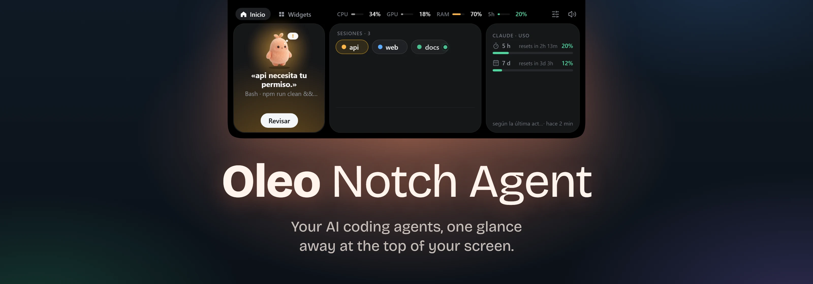
</h1>

<p align="center">
  <b>English</b> · <a href="README.es.md">Español</a>
</p>

<p align="center">
  
  
  
  
  
  <a href="LICENSE"></a>
  <a href="https://github.com/icarlocl/Oleo-Notch-Agent/commits/main"></a>
  <a href="https://github.com/icarlocl/Oleo-Notch-Agent/stargazers"></a>
</p>

<p align="center">
  <a href="#what-is-oleo">What it is</a> ·
  <a href="#what-it-looks-like">Screenshots</a> ·
  <a href="#features">Features</a> ·
  <a href="#install">Install</a> ·
  <a href="#connect-your-agents">Connect</a> ·
  <a href="#how-it-works">How it works</a> ·
  <a href="#privacy-and-network">Privacy</a> ·
  <a href="#build-from-source">Build</a> ·
  <a href="#licence-and-credits">Licence</a>
</p>

## What is Oleo?

You start a few AI coding sessions in different projects, and soon you lose
track of them: which one is working, which one has finished, which one has been
waiting for you for ten minutes.

**Oleo Notch Agent** puts them all in a small island at the top of your screen.
You see every session at a glance, with the project it runs in, its state and
the last thing it said. When an agent asks for permission to run a command or
edit a file, or asks you a question, you answer from the island with one click,
without leaving what you are doing. A peach-coloured plush called **Durazno**
lives in the island and shows how your sessions are doing.

Oleo works with **Claude Code**, **Codex** and **Cursor**. It runs on your
machine and talks to nothing but your own agents: no account, no telemetry.

> [!NOTE]
> Oleo is an early release (version 0.2.3). Windows 10 and 11 are the main
> target; the same code also builds for Linux, which is experimental. The
> interface is in English, Spanish and Portuguese. Oleo is an independent project and is not
> affiliated with or endorsed by Anthropic, OpenAI or Cursor.

## What it looks like

<div align="center">

<picture><source media="(prefers-color-scheme: light)" srcset="docs/assets/screens/hero-light.webp">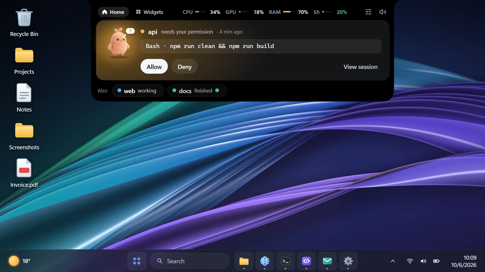</picture>

</div>

<br>

<table>
<tr>
<td width="50%"><picture><source media="(prefers-color-scheme: light)" srcset="docs/assets/screens/over-editor-light.webp">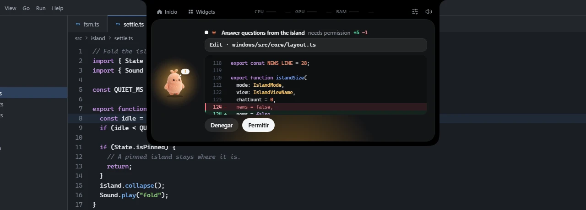</picture><br><sub><b>Approve with a diff.</b> An edit request shows the changed lines before you click.</sub></td>
<td width="50%"><picture><source media="(prefers-color-scheme: light)" srcset="docs/assets/screens/question-light.webp">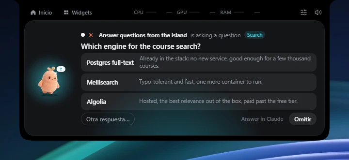</picture><br><sub><b>Answer questions.</b> Pick an option, type your own answer, or skip.</sub></td>
</tr>
<tr>
<td width="50%"><picture><source media="(prefers-color-scheme: light)" srcset="docs/assets/screens/session-agents-light.webp">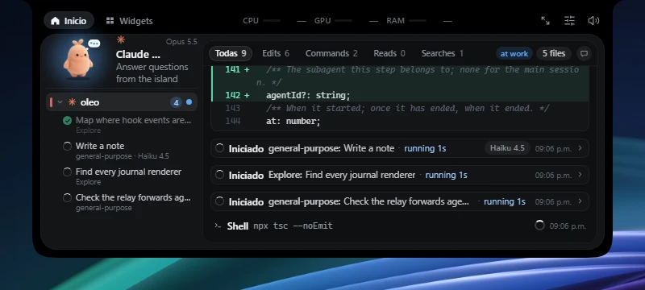</picture><br><sub><b>Follow a session.</b> A journal of what it did, and its subagents.</sub></td>
<td width="50%"><picture><source media="(prefers-color-scheme: light)" srcset="docs/assets/screens/shelf-light.webp">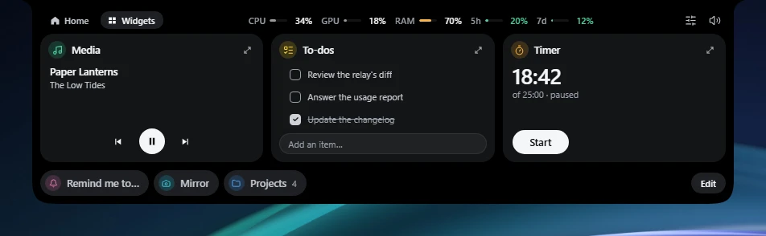</picture><br><sub><b>Widgets.</b> Media, to-dos, a timer, reminders and more, one swipe away.</sub></td>
</tr>
<tr>
<td width="50%"><picture><source media="(prefers-color-scheme: light)" srcset="docs/assets/screens/over-browser-tabs-light.webp">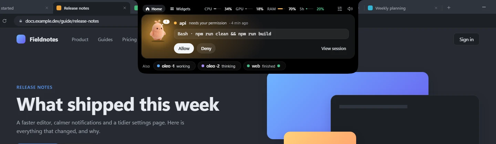</picture><br><sub><b>Out of the way.</b> It floats over the tab strip and takes no space from your page.</sub></td>
<td width="50%"><picture><source media="(prefers-color-scheme: light)" srcset="docs/assets/screens/dock-bottom-light.webp">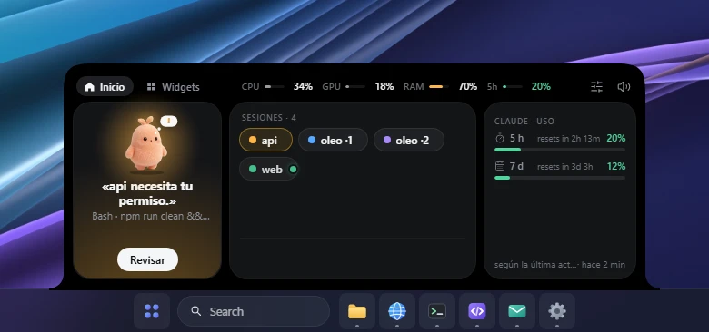</picture><br><sub><b>Dock it anywhere.</b> Top, bottom, left or right edge of the screen.</sub></td>
</tr>
<tr>
<td width="50%"><picture><source media="(prefers-color-scheme: light)" srcset="docs/assets/screens/settings-hooks-diff-light.webp">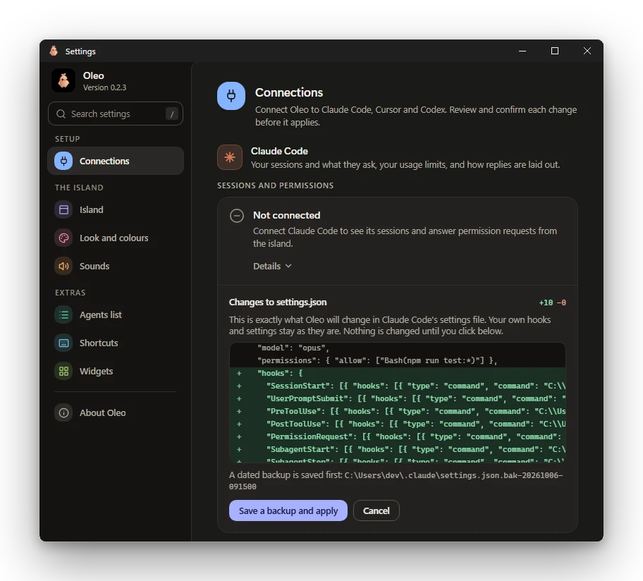</picture><br><sub><b>Nothing changes behind your back.</b> You see the diff of your config before Oleo writes it.</sub></td>
<td width="50%"><picture><source media="(prefers-color-scheme: light)" srcset="docs/assets/screens/settings-look-light.webp">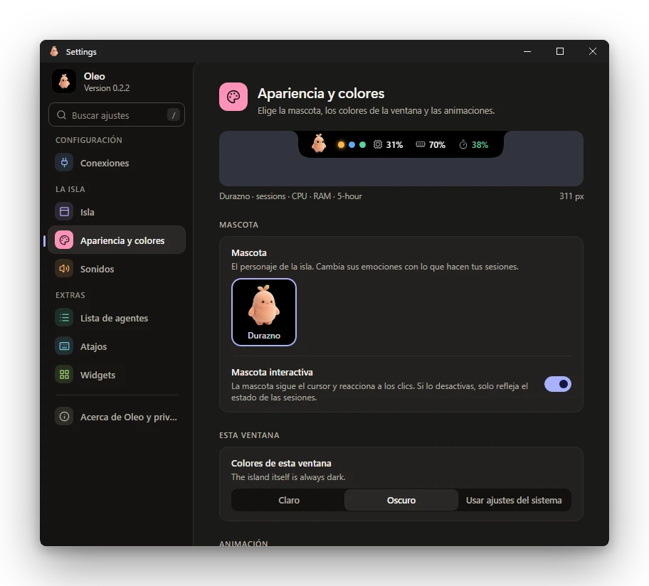</picture><br><sub><b>Meet Durazno.</b> It follows the pointer and reacts to clicks; you can switch that off.</sub></td>
</tr>
</table>

The screenshots are made by the project itself, from the real island driven by
made-up sessions on a made-up desktop (see [Screenshots](#screenshots) below).

## Features

| Feature | What you get |
|---|---|
| **Every session at a glance** | One page for all running sessions: the project, its state (working, needs you, done), the last message, its subagents, and a button back to the window it runs in. |
| **Approve from the island** | Permission requests and questions are answered from the island, for Claude Code and Codex. Edits show a real diff. Nothing is approved without your click. |
| **Reply from the island** | On Windows, when a Claude Code or Codex turn is over, type a reply on its card. Oleo types it into the session's own terminal, or opens the session in VS Code or Cursor with the reply in its prompt box. |
| **Claude Code, Codex and Cursor** | Each session carries the mark of its tool. Claude Code and Codex can be answered from the island; Cursor's agent sessions are shown for their status only. |
| **Usage limits** | Your 5-hour and 7-day Claude limits, taken from Claude Code's own status line, with no network call. Each Claude Code session also shows how full its context is. |
| **Resources** | CPU, GPU and RAM readings next to your sessions. |
| **Durazno** | The mascot wears the status of your sessions and, if you leave it on, follows the pointer and reacts to clicks. |
| **Widgets** | A second tab with Media, To-dos, Timer, Reminders, a camera Mirror and your recent Projects. Each can be switched off and reordered. |
| **Agents list** | An optional small window that stays on top, with one row per project, its state, elapsed time and context size. |
| **Weather** | Optional. Pick a city in Settings and the temperature shows in the island. It is the one feature, besides the update check, that uses the network (see [Privacy](#privacy-and-network)). |
| **Folds and docks** | Folds to a small line near the edge, like a phone's home indicator, that turns amber when a session needs you; or to a capsule with your metrics. Docks to any edge of the screen, hides in full-screen apps, and uses almost no CPU while hidden. |
| **Keyboard and sounds** | Five global shortcuts, all configurable, and soft sounds you can mute. |

### Keyboard shortcuts

| Shortcut | What it does |
|---|---|
| `Ctrl` `Alt` `Space` | Open the session panel large, or shrink it back |
| `Ctrl` `Shift` `Space` | Open the session panel at normal size, with the keyboard in it |
| `Ctrl` `Alt` `Enter` | Go to the window of the session that needs you most, and fold the island |
| `Ctrl` `Alt` `N` | Hide the island, or show it again |
| `Ctrl` `Shift` `L` | Show or hide the agents list (while the list is on) |

You can change or switch off every shortcut in Settings. The defaults avoid
`Ctrl` `Alt` plus a letter, because on many keyboard layouts that is AltGr and
would take a character away from every other program.

## Install

Download `Oleo-Windows-<version>-setup.exe` from the
[latest release](https://github.com/icarlocl/Oleo-Notch-Agent/releases/latest)
and run it. Next to it, `SHA256SUMS.txt` lists the SHA-256 of the installer and
of the two programs inside it. You can also build it yourself (see
[Build from source](#build-from-source)): `npm run pack` writes the same files
to `windows\release\`.

The installer is per-user and needs no administrator rights. It is not
code-signed, so Windows SmartScreen may say "Windows protected your PC": choose
**More info**, then **Run anyway**, once you have checked the hash:

```powershell
Get-FileHash .\Oleo-Windows-0.2.3-setup.exe -Algorithm SHA256
```

WebView2, which draws the island, ships with Windows 10 and 11.

## Connect your agents

Oleo learns about your sessions through the hooks that each tool offers. You
turn them on from **Settings → Connections**, one tool at a time,
with the **Connect…** button under each:

| Tool | What Oleo can do | File it edits, after your click |
|---|---|---|
| **Claude Code** | Show sessions, answer permissions and questions, reply, show usage limits | `~/.claude/settings.json` |
| **Codex** | Show sessions, answer permissions, reply. Codex runs new hooks only once you trust them: start Codex and review them once with `/hooks`. | `~/.codex/hooks.json` |
| **Cursor** | Show agent sessions, status only. It follows only events that cannot change what Cursor does, so it can never allow, deny or delay anything there. Restart Cursor afterwards. | `~/.cursor/hooks.json` |

Every time, Oleo shows you the **exact diff** of what will change, saves a
**dated backup** first, and writes nothing until you click. It touches only its
own entries and never the hooks of other tools. **Desconectar…** removes only
Oleo's entries, the same way. Remove the hooks from Settings before you
uninstall Oleo; uninstalling does not edit your config files.

Then start a new session in your agent and it appears in the island. To see it
without a real agent, run `npm run fake-session` from `windows/` while Oleo is
open: it plays a pretend session through the relay and executes nothing.

## How it works

<p align="center">
  <picture>
    <source media="(prefers-color-scheme: dark)" srcset="docs/assets/how-it-works-en-dark.svg">
    <source media="(prefers-color-scheme: light)" srcset="docs/assets/how-it-works-en-light.svg">
    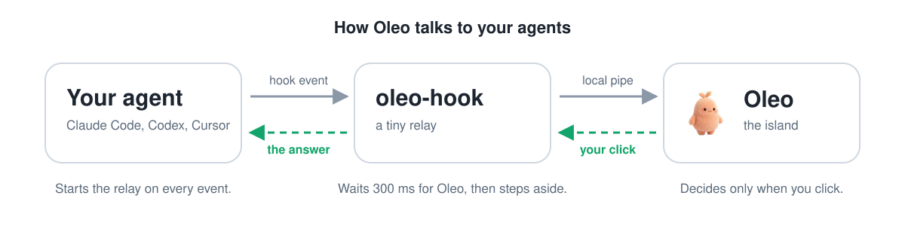
  </picture>
</p>

Each hook runs a tiny relay, `oleo-hook`. It sends the event to Oleo over a
named pipe, `\\.\pipe\oleo-<your user SID>`, which only your Windows account
(and the system) can open. When the event is a question or a permission
request, the relay waits for your click and hands the answer back to the agent.

- **It never blocks your agent.** The relay gives Oleo 300 ms to pick up. If Oleo
  is closed, slow or has crashed, the relay exits at once and the agent carries on
  as if Oleo were not installed, asking in its own terminal as usual.
- **It never approves anything without a click.** If nobody answers in time, Oleo
  says nothing and the agent asks as it always does.
- **It has no network code.** The relay makes no network calls at all.

## Privacy and network

- **No telemetry, no tracking, no account.**
- **Two optional features use the internet, and both are off until you turn
  them on:**
  - *Update check* (Settings → About, off by default, or **Check now**). It asks
    GitHub's API for the latest release of this repository and sends only a
    `User-Agent: Oleo/<version>` header, nothing about you or your machine. Oleo
    never downloads or installs anything by itself: it only opens the download
    in your browser.
  - *Weather* (Settings → Island, **Clima**). When you search for a city, the text
    you type goes to Open-Meteo's geocoding API; when a city is selected, its
    coordinates go to Open-Meteo's forecast API, at most every 15 minutes while
    the island is open. Remove the city to turn it off.
- The window's content security policy allows those two hosts and nothing else.
- What the relay reads (the tail of a transcript, the file an edit targets,
  command output) goes only to Oleo over the local pipe and stays in memory. The
  log records event names and decisions, never their content.
- Everything Oleo keeps is on your machine: preferences in `%APPDATA%\Oleo` and
  the relay and log (`oleo.log`) in `%LOCALAPPDATA%\Oleo`.
- WebView2, the Microsoft component that draws the window, is updated by
  Microsoft outside Oleo's control.

Found a vulnerability? Please report it privately, as described in
[`SECURITY.md`](SECURITY.md).

## Build from source

You need Rust (stable, MSVC toolchain), Visual Studio Build Tools with the MSVC
x64/x86 tools and a Windows 11 SDK, and Node 20 or newer.

```powershell
cd windows
npm ci
npm run tauri dev       # development build with live reload
npm run pack            # release build: the installer and SHA256SUMS.txt in windows\release\
npx tsc --noEmit        # type-check the front end
cargo test --workspace  # Rust tests
```

[`windows/README.md`](windows/README.md) covers the hooks, where Oleo keeps its
files and the layout of the code. Contributions are welcome: see
[`CONTRIBUTING.md`](CONTRIBUTING.md). Builds must pass with no warnings.

### Project layout

```text
windows/
  src/          front end in TypeScript, no framework: island, views, settings, widgets, mascot
  src-tauri/    the Rust app: window, relay server, hook installer, settings, platform code
  hook/         oleo-hook, the relay each hook starts
  scripts/      fake session, installer packaging, icon and screenshot generators
  dev/          the screenshot stage: the real island on a made-up desktop
docs/           notes and the images used by this README
```

### Screenshots

The images in this README come from one command. From `windows/`, with Node 22
or newer and Edge or Chrome installed:

```powershell
npm run shots -- --out ..\docs\assets\screens --only hero,over-editor,question
```

## Licence and credits

Oleo is open source, released under the [MIT License](LICENSE). Copyright ©
2026 Franco Ruiz; the parts that come from Nook and Coucou keep Louis Raillé's
copyright notice, which is in [`LICENSE`](LICENSE) too. Third-party notices are
in [`NOTICE`](NOTICE).

Durazno, the app icons and the installer artwork are Oleo's own and are covered
by the same licence. What the licence does not give is the use of the names
"Oleo" and "Oleo Notch Agent", or of Durazno, as the brand of another product;
see [`LICENSE-ASSETS.md`](LICENSE-ASSETS.md).

Oleo is derived from [Nook](https://github.com/zubairbinshaukat/nook) by Zubair
Bin Shaukat, which is a fork of [Coucou](https://github.com/Louis-CFM/coucou) by
Louis Raillé, built on the Windows multi-session work of
[Edurique](https://github.com/Edurique/coucou_edu_windows_implementation).
Interface icons are from [Lucide](https://lucide.dev) and
[Simple Icons](https://simpleicons.org). The banner is set in
[Bricolage Grotesque](https://fonts.google.com/specimen/Bricolage+Grotesque)
(SIL Open Font License).

"Claude" and "Claude Code" are trademarks of Anthropic. "Codex" is a trademark
of OpenAI. "Cursor" is a trademark of Anysphere. They are named here only to say
which tools Oleo works with.

<br>

<p align="center">
  Made by <a href="https://github.com/icarlocl">Franco Ruiz</a><br>
  <sub>If Oleo saves you a trip to the terminal, a ⭐ helps others find it.</sub>
</p>
